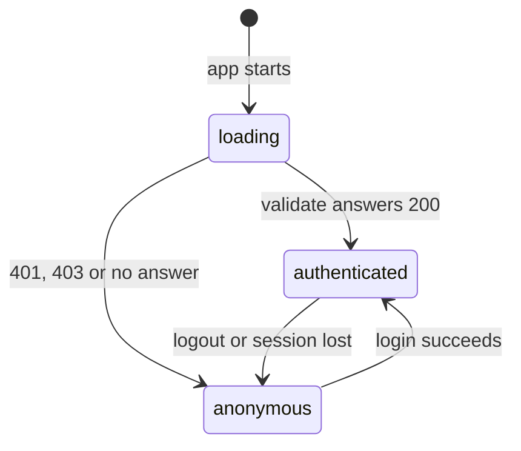
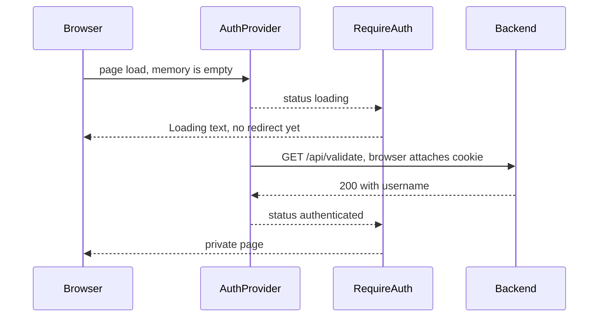
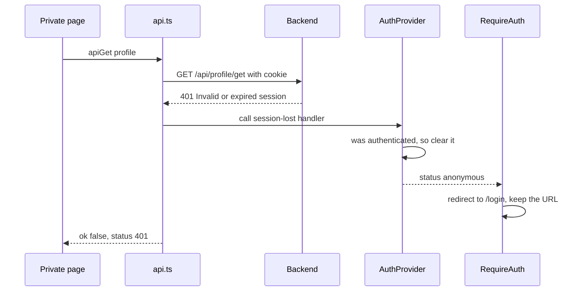

# How the auth session works

Issue #13. The session is an `HttpOnly` cookie that JavaScript can't read, so the frontend asks the backend who is logged in with `GET /api/validate`.

| File | Job |
|---|---|
| [`AuthProvider.tsx`](../frontend/src/components/AuthProvider.tsx) | Owns the status; runs the check, login and logout |
| [`RequireAuth.tsx`](../frontend/src/components/RequireAuth.tsx) | Route guard: loading text, redirect or page |
| [`api.ts`](../frontend/src/lib/api.ts) | All `fetch` calls; reports a lost session |
| [`Login.tsx`](../frontend/src/pages/Login.tsx) | Form, redirect back, "session expired" message |

## The three statuses

## Refreshing a private page

A refresh wipes React's memory, but the browser keeps the cookie.

## Session lost during use

A lost session is any `401`, or a `403` with the exact error `Forbidden`.

## Good to know

- **No redirect loop:** the handler only changes state, and `/login` isn't guarded.
- **`/api/validate`, not `/api/me`:** the issue asks for `/api/me`, but that route doesn't exist.
- **"Expired" isn't about time (read from the code, not run):** tokens have no time limit. A second login replaces the stored token, which kills the first session.
- **Logout (read from the code, not run):** it only clears the cookie, so a copied token works until the next login.
- **Test gaps:** all 120 tests still pass without the check at `AuthProvider.tsx:47`, and without `AUTH_CALL`.
- **Not confirmed yet:** the full flow in a browser.
